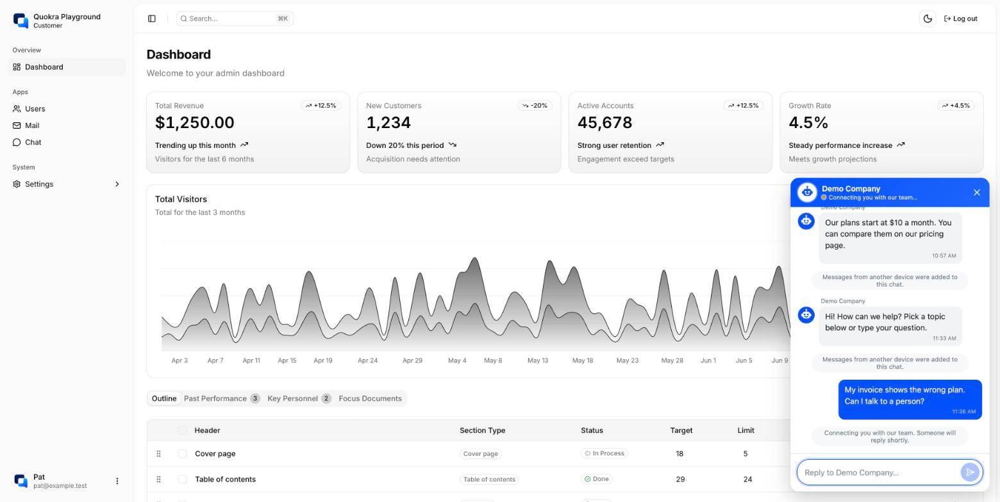
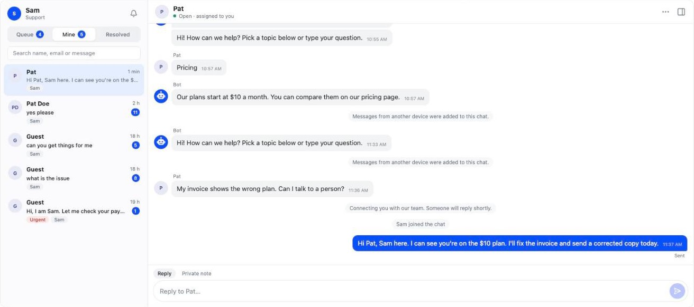

<p align="center">
  
</p>

<h1 align="center">Quokra Playground</h1>

<p align="center">
  A realistic admin dashboard with <a href="https://github.com/mesubash/quokra">Quokra</a>
  embedded, for trying Quokra the way a real app uses it.
</p>

<p align="center">
  React 19 · Vite · TypeScript · Tailwind CSS v4 · shadcn/ui
</p>





## Pages

- **Landing** (`/`): presents Quokra: how it works, what you get, the live
  demo, roadmap and FAQ
- **Docs** (`/docs`): integration snippets, API overview, customization and
  security for developers
- **Login** (`/login`): mock sign-in with two tabs. **Customer**: any email, no
  password. **Support agent**: pick Sam or Alex, the demo agents in Quokra's
  dev data. The session is stored in `localStorage` and a cookie for the dev
  backend (see `src/lib/auth.ts`); signed-out visitors are sent to `/login`.
  Log out sits in the header and the user menu.
- **Dashboard**: stat cards, an area chart and a data table
- **Users**: user table with add/edit dialog
- **Mail**: inbox with a reading pane
- **Chat**: conversation list and messages
- **Settings**: user, account, appearance and notifications
- **Support** (`/support`, agents only): the full Quokra agent console

The pages use sample data from local JSON files under `src/app/*/data`.

## Getting started

Requires Node 20.19+ (see `.nvmrc`) and pnpm.

```bash
pnpm install
pnpm dev       # http://localhost:5173
pnpm build     # type-check and build to dist/
pnpm lint
```

## Quokra

This app embeds [Quokra](https://github.com/mesubash/quokra) the way a real app would:

- **Visitors and customers** get the Quokra chat bubble on every page. Signed-in
  customers are identified, so the support team sees who they are.
- **Agents** get a **Support** page with the full console, and the console bubble
  on every other page.

Sign in as a customer (any email) or as a demo agent (Sam or Alex). Open both in
two windows, or one in a private window, to see the chat live.

### Running it

1. Start Quokra locally with the dev profile (see Quokra's `docs/DEVELOPMENT.md`).
   Its dev data already allows `http://localhost:5173` and has both demo agents.
2. `cp .env.example .env.local` (the defaults match Quokra's dev setup).
3. `pnpm dev`

### How the tokens work

Quokra needs two tokens that a real app's backend provides. Here a small dev
backend inside the Vite server stands in for it (`dev/quokra-api.ts`):

- `POST /api/quokra/identity`: signs a 5-minute identity token for the signed-in
  customer with `QUOKRA_SECRET_KEY`. The key stays on the server side.
- `POST /api/quokra/agent-token`: gets an agent token from Quokra's dev endpoint.
  A real dashboard would pass on the access token from its own login (OIDC).

The browser side is in `src/lib/quokra.ts`, `src/components/quokra/` and
`src/app/support/`.

## Copy rules

When editing the marketing pages (`src/app/landing/`, `src/app/docs/`), keep
the claims true to Quokra v1. The Quokra repo's `README.md` and `docs/` are the
source of truth.

- **Say:** FAQ bot from a per-company file; human handoff in the same
  conversation; chat as bubble, inline or popup; console as full page or
  drawer; agent login through the host's OIDC; customer identify with HS256
  tokens of at most 5 minutes; light/dark, accent colour, per-company wording.
- **Don't say** (not built yet): AI answers or "AI-powered", WhatsApp or email
  channels, analytics or CSAT, a hosted SaaS, pricing or sign-up, attachments,
  canned replies, business hours. These may appear only on the roadmap,
  marked as planned.
- **Tone:** plain, short, concrete. No "revolutionary" or "seamless".

## Project layout

```
src/
  app/          one folder per page (page.tsx, components/, data/)
  components/   layout, sidebar, header and shadcn/ui components (ui/)
  config/       routes
  contexts/     theme and sidebar state
  hooks/        shared hooks
public/         logo.png, favicons and site.webmanifest
dev/            dev backend for Quokra tokens (runs inside the Vite server)
docs/           content brief for the landing page
```

To add a page, create `src/app/<name>/page.tsx`, register it in
`src/config/routes.tsx`, and link it from `src/components/app-sidebar.tsx`.

## Credits

Based on [shadcn-dashboard-landing-template](https://github.com/shadcnstore/shadcn-dashboard-landing-template)
by [ShadcnStore](https://shadcnstore.com), trimmed down to the dashboard, a few
apps and settings.

## License

The code is MIT licensed. See [License.md](License.md).

The Quokra name and logo (`public/logo.png` and the favicons in `public/`) are
not covered by the MIT license and may not be reused without permission.
